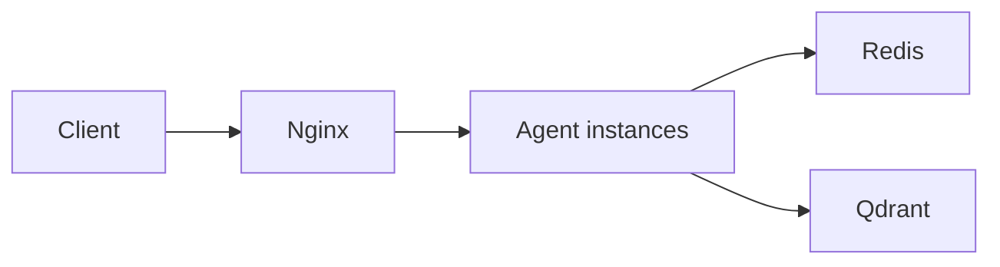

# Day 14 — Mission Answers

## Part 1: Localhost vs Production

### Exercise 1.1 — Anti-patterns
Trong `01-localhost-vs-production/develop/app.py`:
1. `OPENAI_API_KEY` và `DATABASE_URL` nằm trong source; đổi môi trường phải sửa code, secret dễ lộ qua Git.
2. `print` ghi cả API key ra console, làm lộ credential trong log.
3. `DEBUG=True`, `reload=True` không phù hợp với môi trường phục vụ người dùng.
4. Bind `localhost` khiến app không nhận được traffic từ ngoài container.
5. Cổng 8000 cố định, không đọc `PORT` do cloud cấp.
6. Thiếu `/health` và `/ready`; platform không biết instance còn sống hay sẵn sàng.
7. Chưa có lifecycle shutdown để đóng kết nối sau khi xử lý request đang chạy.
8. Chưa có xác thực, giới hạn request hay ngân sách.

### Exercise 1.2 — Chạy bản develop
Đã gọi POST `/ask?question=Hello` và nhận 200. Bản develop nhận query, gửi JSON đơn thuần sẽ không đáp ứng tham số bắt buộc. Output thật ở phần bằng chứng bên dưới.

### Exercise 1.3 — So sánh
| Feature | Develop | Production | Vì sao cần |
|---|---|---|---|
| Config | Giá trị cố định trong code | `config.py` đọc env | Một image chạy nhiều môi trường |
| Bind/port | localhost:8000 | 0.0.0.0 và PORT | Nhận traffic trong container/cloud |
| Logging | print, lộ key | log có trường sự kiện | Tìm lỗi và tránh lộ secret |
| Liveness | Không có | `/health` | Platform phát hiện process lỗi |
| Readiness | Không có | `/ready`, trạng thái khởi tạo | Chỉ route traffic tới instance sẵn sàng |
| Shutdown | Không dọn tài nguyên | lifespan startup/shutdown | Hoàn tất request rồi đóng kết nối |

Lưu ý: ví dụ production Part 1 dùng formatter ghép chuỗi JSON; Part 6 dùng `json.dumps` để escape nội dung đúng.

## Part 2: Docker

### Exercise 2.1
1. Base image của bản develop: `python:3.11`.
2. Working directory: `/app`.
3. Copy requirements trước source giúp tái sử dụng layer cài dependencies khi chỉ thay code.
4. CMD cung cấp lệnh/đối số mặc định và có thể bị thay khi `docker run`. ENTRYPOINT xác định executable chính; đối số lúc run thường nối vào ENTRYPOINT. Exec form giúp process nhận signal trực tiếp.

### Exercise 2.2–2.3
Build từ gốc repo bằng hai Dockerfile trong `02-docker/`. Số byte đo thực tế từ docker image inspect:

| Image | Byte | MB (10^6 byte) |
|---|---:|---:|
| my-agent:develop | 426320163 | 426.32 |
| my-agent:advanced | 57409126 | 57.41 |

Giảm `(426320163 - 57409126) / 426320163 × 100` = 86,53%. Đây là trường Size từ Docker inspect, không phải dung lượng truyền qua registry hoặc dung lượng shared layer duy nhất trên đĩa. File gốc: `reports/image-sizes.txt`.
Container develop trả HTTP 200; stack Part 2 qua Nginx trả 200 ở cả `/health` và POST `/ask`. Output thật: `reports/part2-http.txt`, `reports/part2-nginx-http.txt`.
Stage builder cài dependency; runtime chỉ lấy dependency và source cần thiết, dùng base slim, bỏ compiler và cache không cần thiết. Dung lượng phụ thuộc cả base image lẫn package; multi-stage tự nó không đảm bảo image nhỏ.

### Exercise 2.4

Nginx nhận cổng 80/443 và proxy tới agent:8000. Agent dùng Redis qua tên service `redis`, Qdrant qua `qdrant:6333`; Docker network cung cấp DNS nội bộ. Redis giữ dữ liệu qua volume; Qdrant lưu vector qua volume riêng. `depends_on` với healthcheck giúp agent khởi động sau khi dependency healthy.

## Part 3: Cloud Deployment

### Exercise 3.1–3.2
Trạng thái URL và cách deploy agent Part 6: xem `DEPLOYMENT.md`. Chưa có URL public thì chưa coi phần deploy là hoàn thành.

| Nội dung | Railway | Render |
|---|---|---|
| File | railway.toml | render.yaml |
| Build | builder DOCKERFILE | web service runtime docker |
| Health check | deploy.healthcheckPath | healthCheckPath |
| Redis | Tạo service Redis rồi tham chiếu REDIS_URL | Blueprint khai báo keyvalue, fromService nối URL |
| Secret | Đặt variable trên service | generateValue hoặc sync:false |
| Port | PORT do nền tảng cấp | PORT do nền tảng cấp |
Railway TOML mô tả cách build/deploy một service; Render YAML có thể mô tả cả web lẫn Redis và liên kết chúng. Cả hai dùng `/health`, còn `/ready` được kiểm riêng để xác nhận Redis kết nối được.

### Exercise 3.3 — Cloud Run
`cloudbuild.yaml` cài dependencies và chạy pytest, sau đó build Docker image với tag commit SHA và latest.
Khi bước build xong, pipeline push các tag lên Container Registry rồi deploy image theo SHA lên Cloud Run ở asia-southeast1.
Bước deploy đặt giới hạn instance, CPU, RAM, timeout, environment và tham chiếu Secret Manager.
`service.yaml` mô tả service: concurrency 80, scale 1–10 instance, probes và secret reference; file này dùng khi deploy bằng `gcloud run services replace`.
Cần chú ý script test mẫu chưa có `set -e`: khi dùng thật phải bảo đảm pytest fail khiến bước CI fail trước khi build/deploy.

## Part 4: API Security

### Exercise 4.1
API key được kiểm tra tại dependency trước khi gọi LLM. Thiếu/sai key trả 401. Rotate bằng cách tạo key mới ở biến môi trường, cập nhật client rồi thu hồi key cũ; không đặt key thật vào source hoặc log.

### Exercise 4.2–4.3
POST `/auth/token` với tài khoản demo student tạo JWT; client gửi `Authorization: Bearer <token>` cho `/ask`. Server kiểm chữ ký HS256 và thời gian hết hạn. JWT là credential, không được công khai trong báo cáo.
Rate limiter mẫu Part 4 dùng deque timestamp trong RAM: sliding window 60 giây, user 10 request/phút, admin 100 request/phút. Admin được cấp hạn mức cao hơn, vẫn có giới hạn. RAM không chia sẻ giữa worker nên Part 6 thay bằng Redis sorted set với Lua atomic.

### Exercise 4.4
Cost guard kiểm tổng USD đã tiêu trước khi gọi LLM, sau đó cộng input/output token theo bảng giá. Part 6 lưu tổng theo ngày và tháng UTC trong Redis, dùng key chứa ngày/tháng để tự chuyển kỳ, TTL dọn kỳ cũ. Tổng vượt ngưỡng trả 402; rate limit trả 429. Rate limit bảo vệ tốc độ, budget bảo vệ tiền khi mỗi request có số token khác nhau.
Giới hạn hiện tại: kiểm tra trước và ghi nhận sau request nên nhiều request đồng thời có thể vượt budget một ít; production thật cần reserve chi phí ước tính một cách atomic, sau đó reconcile với usage thật.

### Bằng chứng HTTP đã chạy
```text
Part 1 query /ask: 200 {"answer":"Đây là câu trả lời từ AI agent (mock). Trong production, đây sẽ là response từ OpenAI/Anthropic."}
Part 4 no auth: 401 {"detail":"Authentication required. Include: Authorization: Bearer <token>"}
POST /auth/token: 200 [token redacted]
POST /ask: 200 {"question":"Docker","answer":"Container là cách đóng gói app để chạy ở mọi nơi. Build once, run anywhere!","usage":{"requests_remaining":9,"budget_remaining_usd":1.8e-05}}
POST /ask: 429 {"detail":{"error":"Rate limit exceeded","limit":10,"window_seconds":60,"retry_after_seconds":59}}
POST /ask: 429 {"detail":{"error":"Rate limit exceeded","limit":10,"window_seconds":60,"retry_after_seconds":59}}
12 sequential requests: [200, 200, 200, 200, 200, 200, 200, 200, 200, 200, 429, 429]

```

## Part 5: Scaling & Reliability

### Exercise 5.1
`/health` là liveness: process còn phục vụ được thì 200 dù Redis lỗi. `/ready` ping Redis: lỗi trả 503 để load balancer tạm ngừng route request. Restart process khi dependency lỗi không chắc sửa được dependency và có thể gây vòng lặp restart.

### Exercise 5.2
Uvicorn nhận SIGTERM, ngừng nhận request mới và đợi request in-flight hoàn tất; lifespan đóng Redis sau đó. Docker dùng `exec uvicorn` để Uvicorn là PID 1 và nhận signal; timeout graceful 8 giây, stop grace 10 giây. Kết quả thực nghiệm Part 6 có ở checklist phía dưới.

### Exercise 5.3
State trong dict RAM khác nhau ở từng instance và mất khi restart. Redis là nơi dùng chung cho rate limit, chi phí và session ở ví dụ scaling. Không đưa API key nguyên văn vào tên key Redis; Part 6 hash key bằng SHA-256.

### Exercise 5.4–5.5
Stack Part 5 gồm Nginx cổng 8080, 3 agent và Redis. POST `/chat` với cùng session_id phải lấy được history xuyên instance. Script `test_stateless.py` gửi 5 câu và đọc history; script không tự kill instance. Đã chạy thật: 5 request được phân phối qua 3 instance, history cuối chứa đủ 10 message (5 user + 5 assistant). Kết quả ở `reports/scaling-stateless.txt`. Thí nghiệm này kiểm tra chia sẻ state, không tự kill instance; thí nghiệm pause có đo riêng ở báo cáo observability.

## Part 6: Production agent
Đã hoàn thiện các module trong `06-lab-complete/app/`, Dockerfile multi-stage, compose agent + Redis, env example và cấu hình deploy Railway/Render. Script chấm và golden dataset được giữ nguyên.

Chạy bằng Python 3.11 trong Ubuntu WSL, Docker Desktop Linux engine. Docker credential helper Windows trong WSL gây exec format error nên dùng DOCKER_CONFIG riêng chỉ có auths rỗng cho lab, không sửa credential cá nhân.

Output script chấm đầy đủ (bản gốc: `reports/production-readiness.txt`):
```text
  📋 Checklist Deliverable
     ✅ Dockerfile (multi-stage, < 500 MB)
     ✅ docker-compose.yml (agent + redis)
     ✅ .dockerignore
     ✅ Health check endpoint (GET /health)
     ✅ Readiness endpoint (GET /ready)
     ✅ API Key authentication
     ✅ Rate limiting
     ✅ Cost guard
     ✅ Config từ environment variables
     ✅ Structured logging
     ✅ Graceful shutdown
     ✅ Public URL ready (Railway / Render config)
----------------------------------------------------------------
  Result: 12/12 tiêu chí đạt · 43/43 checks passed
  🎉 PASS 12/12 — PRODUCTION READY! Deploy nào!
================================================================


```

## AI log

| Yêu cầu | AI hỗ trợ | Kiểm tra đã thực hiện | Người học cần tự xác nhận |
|---|---|---|---|
| Đọc folder và làm bài Day 14 | Codex đọc README, RULES, SUBMISSION, RUBRIC, CHECKPOINTS và code mẫu; hoàn thiện agent Part 6, scripts và báo cáo | Chạy script chấm gốc trong WSL với Docker: 12/12, 43/43 checks | Đọc và giải thích được từng module, không coi việc AI chạy thay là đã tự kiểm |
| Benchmark và sửa chất lượng | Codex chạy load/eval, xác định thiếu JWT và HPA, bổ sung KB ở develop và production | Eval baseline và fixed trên dataset giữ nguyên, kiểm regression, lưu JSON thật | Tự đọc số đo và giải thích trade-off |
| Trả lời bài và đóng gói | Codex soạn câu trả lời từ source và output thực tế | Đối chiếu với báo cáo gốc; ghi rõ phần chưa chạy hoặc chưa có bằng chứng | Chỉnh theo hiểu biết cá nhân và chạy lại các lệnh trước khi nộp |

AI log này ghi công việc AI thực sự đã làm, không khẳng định người học đã tự sửa hay tự chạy khi chưa xác nhận.

Các bước bổ sung trong cùng phiên AI: sửa home user trong Dockerfile observability mẫu; chuyển Grafana sang cổng 3001; dùng --no-deps để giữ đúng replica khi chạy Locust; chạy kết hợp lỗi/chậm, đổi model, pause instance và eval v1; chụp 4 ảnh observability. Có một lượt scaling bị gián đoạn làm duration không phù hợp nên giữ riêng evidence cũ và chạy lại; bảng cuối chỉ dùng CSV của lượt chạy lại. Người học trực tiếp đăng nhập Render, chọn repo và tạo Blueprint; AI chuẩn bị và push cấu hình Free cùng source đã kiểm tra. URL cloud vẫn cần xác minh trước khi nộp.
